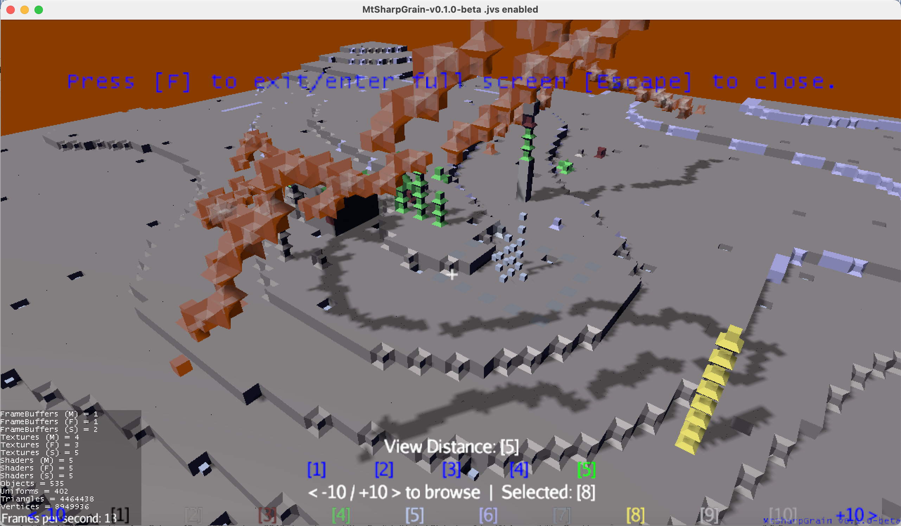
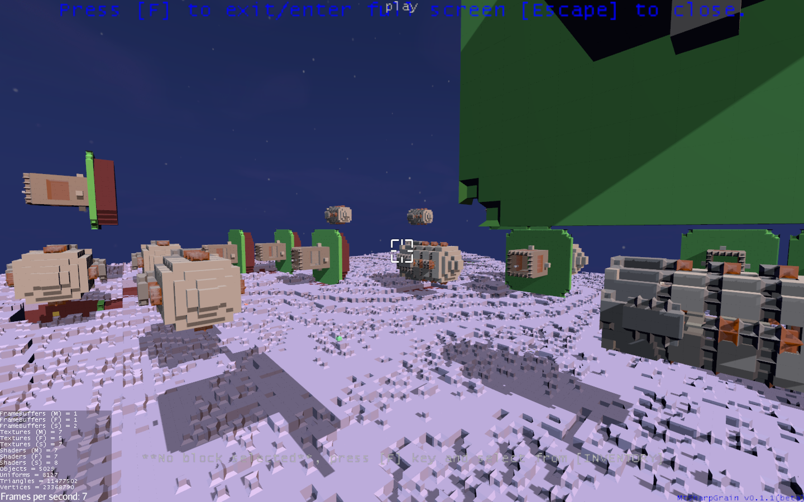
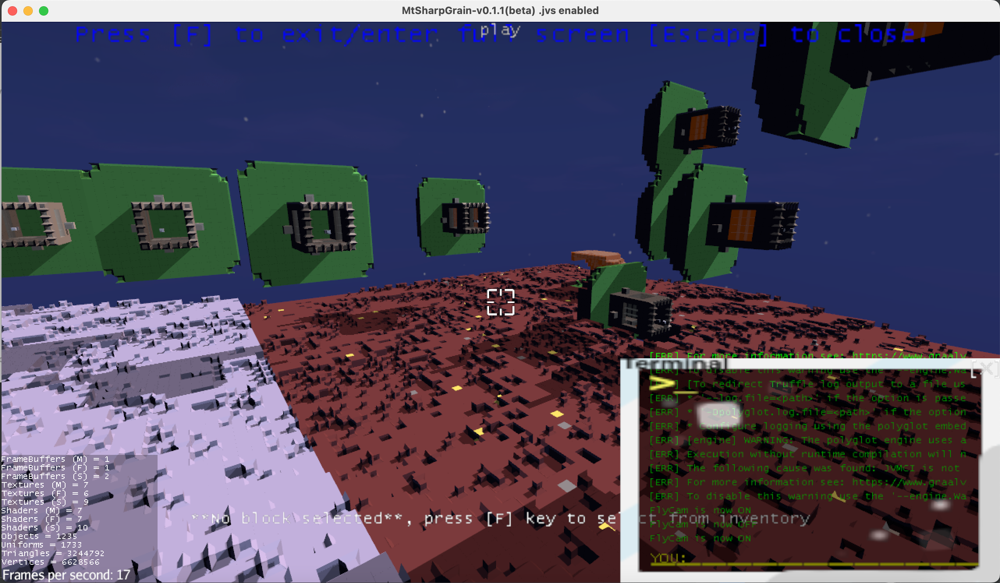
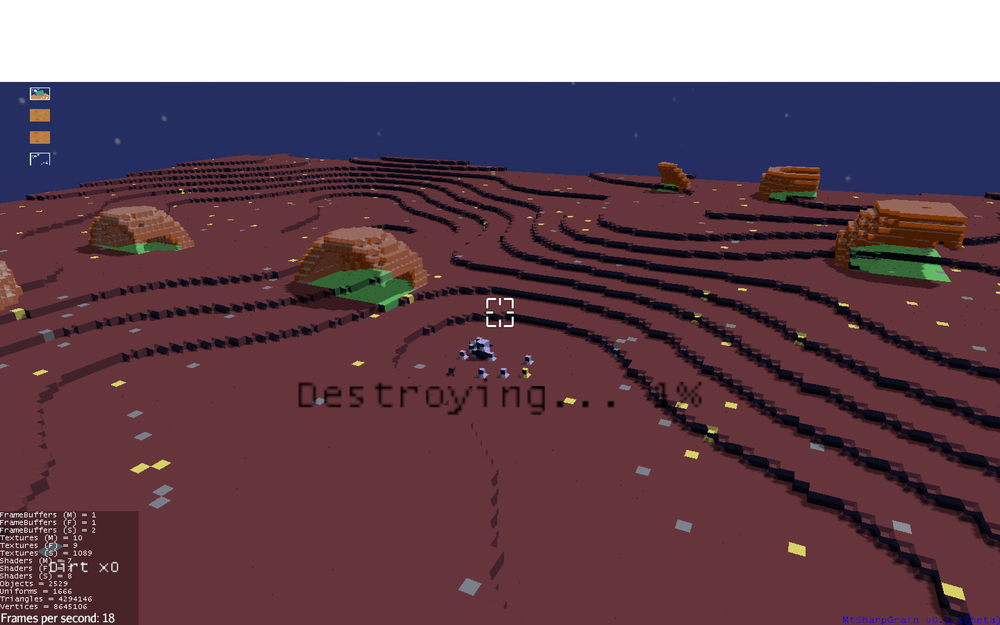
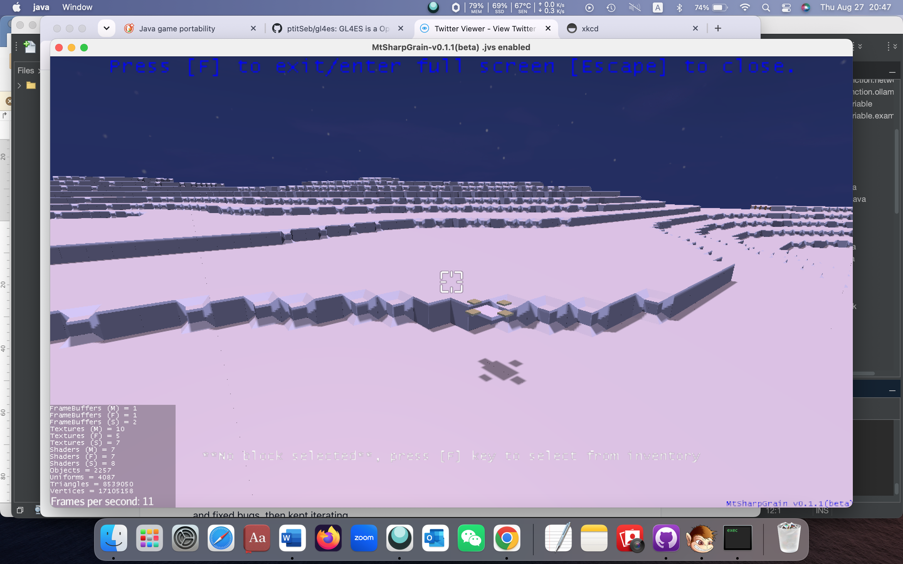
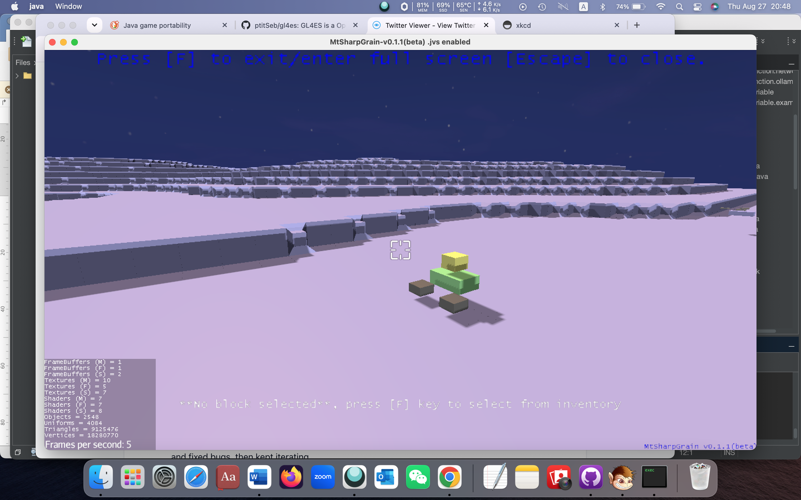
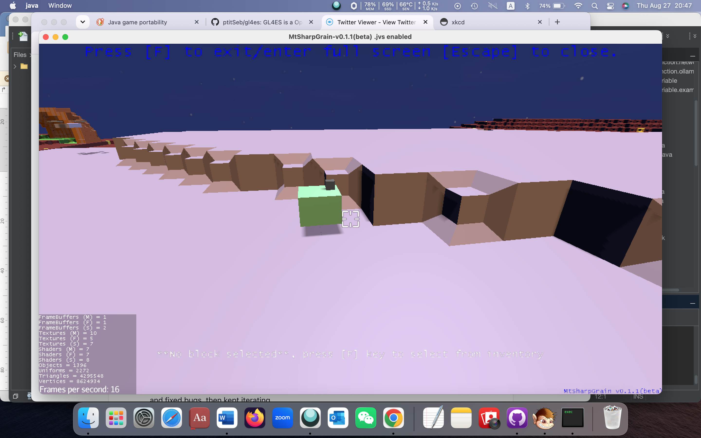
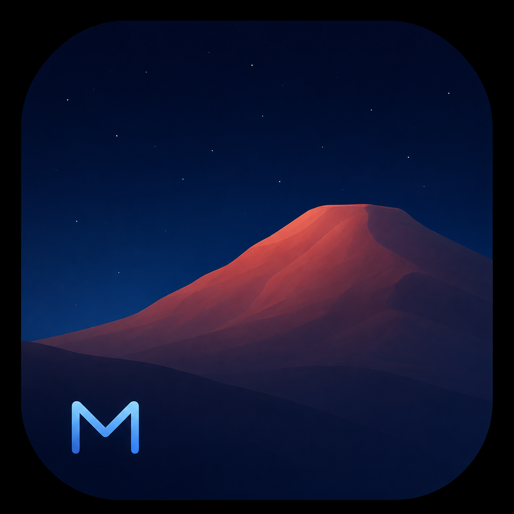

 

# MtSharpGrain 

  _<-- constantly improving!_

_If you don't see any comits in the last few days, I have been lazy._

Just another kind of voxel game with some strange, slightly smooth interconnected blocks rather than traditional blocks. But I am focusing on making a good plugin/modifier system.

It is coded 100% in java (openGL lwjgl and jMonkeyEngine).

---
The most special part of this game is the [JavaScript modifier system](https://github.com/OxillenGlow/MtSharpGrain/wiki/2.1-Code) 
A pretty full modifier/plugin system to allow for JavaScript modding via GraalJS.

Why mods?
- I just like them way too much for some reason.(probably just me loving how minecraft mods allowed the game to have almost infinite things to explore)
- I am a single person and I do not have the resources to make a full game with everything.
- I will **not** be able to make my game fit everyone's taste.

Currently, mods can:
- Move the player around
- Change the world
- Make websocket connections
- Add new blocks
and some more stuff...

Modding solves both as **anyone including you!** can make *their own mini game* on top without messing with boring parts.

Like the idea? **[download now](https://github.com/OxillenGlow/MtSharpGrain/releases)** And go [here](https://github.com/OxillenGlow/MtSharpGrain/wiki/2.1-Code) to learn more on the modding system.

Other than mods, its basically another sandbox game with a procedually generated world

---

#### [Download Here](https://github.com/OxillenGlow/MtSharpGrain/releases)
available for MacOS, Windows, and Linux

---

## Screen shots/Showcase

 Click here to see screen shots

 
 
The latest looks of the world.

A bunch of sideways houses... I think i like this? I think it looks kind of cool?

Small greenhouses with grass(edible? idk yet) inside.

Three common NPCs (there are more!):

A drone?

A duck? (rover)

Anouther one.

---

### Links

- 📖 **[Wiki](https://github.com/OxillenGlow/MtSharpGrain/wiki)**
- 💬 **[Discussions](https://github.com/OxillenGlow/MtSharpGrain/discussions)**

---

---

      m   m           s s s s            g g g
    m   m   m       s                  g
    m   m   m         s s s            g   g g g
    m       m               s          g       g
    m       m t     s s s s   harp       g g g   rain

---

### ⭐ [Other Projects ✨](https://github.com/OxillenGlow)
[My other projects](https://github.com/OxillenGlow)
### This project uses:

- **JavaMonkeyEngine** (and everthing that LWJGL has)
Website: https://www.jmonkeyengine.org
GitHub organization: https://github.com/jmonkeyengine
- **Riccardobl's simple IGui** for jme
GitHub source: https://github.com/riccardobl/jme-igui
- **Neuroph** for mlp (unused)
GitHub source: https://github.com/neuroph/NeurophFramework 
- **jVisualScripting** for visual scripts and engine (unused) see
GitHub source: https://github.com/openconcerto/jVisualScripting
- **GraalVM's community GraalJS** for the javascript modules
GitHub source: https://github.com/oracle/graaljs
- **Kenney Assets** for great free CC0 assets
Available at: https://kenney.nl/assets
- **And much more who has made coding this easier for me and free**

#### AI?

Yes, I use claude(and now other ais) a lot, perhaps too much? idk just speeds things up and removes need for constantly checking the API of whatever thing is implemented. Also, to be honest, Claude write code with less bugs and faster than me.

This is only for code, all assets/ideas are human made (not that i use a lot of assets).
